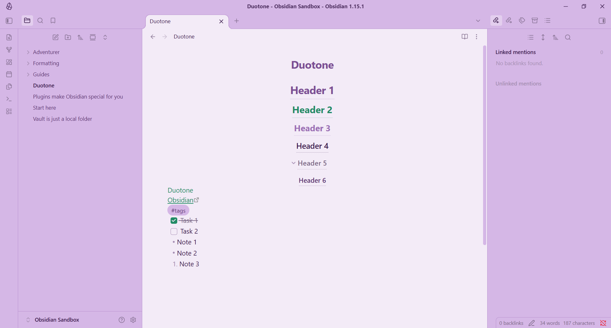
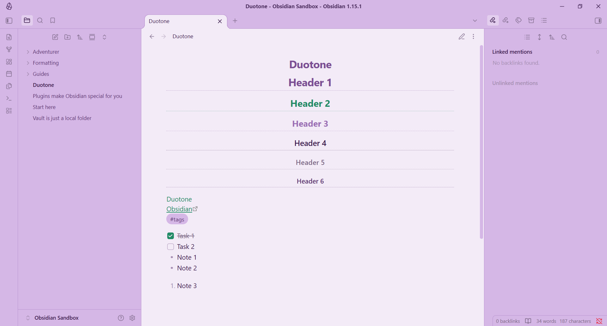
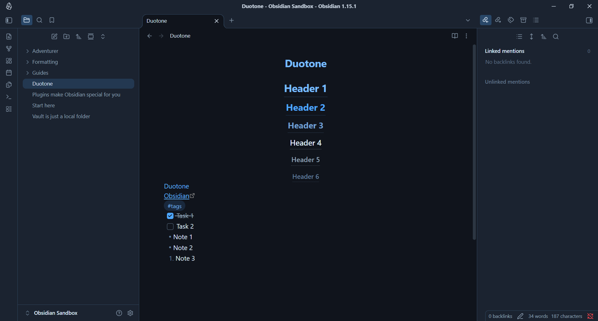
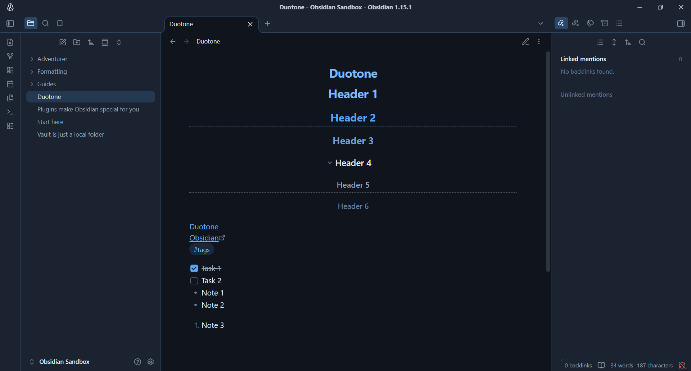

# Duotone

[English](README.md) | [Русский](README-RU.md)

Duotone — пользовательская тема оформления для Obsidian, включающая две самостоятельные цветовые палитры, центрированные заголовки и единый визуальный стиль рабочего пространства.

Тема сочетает мягкое светлое оформление в лавандовых тонах с зелёными акцентами и холодное тёмно-синее оформление с яркими голубыми акцентами.

# Предпросмотр

### Светлый режим

**Редактор**

**Режим просмотра**

### Тёмный режим

**Редактор**

**Режим просмотра**

## Особенности

- Две самостоятельные цветовые палитры для светлого и тёмного режимов.
- Собственные цвета для всех шести уровней заголовков Markdown.
- Центрирование заголовков Markdown и названий заметок.
- Пунктирные линии под заголовками в режиме просмотра и редакторе с динамическим предпросмотром.
- Центрирование встроенных изображений в режиме просмотра.
- Настроенная подсветка синтаксиса.
- Оформление внутренних и внешних ссылок.
- Собственное оформление тегов, флажков и таблиц.
- Настроенные цвета проводника файлов, вкладок, меню, диалоговых окон и других элементов интерфейса.
- Собственные цвета графа связей.
- Отсутствие необходимости в дополнительных расширениях.

## Цветовые палитры

### Светлый режим

Мягкая лавандовая палитра с зелёными акцентами.

| Элемент | Цвет |
| --- | --- |
| Основной фон | `#F3EBF7` |
| Второстепенный фон | `#D5B7E6` |
| Основной текст | `#3A1C4C` |
| Акцент | `#228B66` |

### Тёмный режим

Холодная тёмно-синяя палитра с яркими голубыми акцентами.

| Элемент | Цвет |
| --- | --- |
| Основной фон | `#10141C` |
| Второстепенный фон | `#1B2330` |
| Основной текст | `#DCE8F5` |
| Акцент | `#4DA6FF` |

## Установка

В настоящее время Duotone распространяется через GitHub и пока недоступна в официальном каталоге пользовательских тем Obsidian.

### Ручная установка

1. Скачайте файлы `theme.css` и `manifest.json` из этого репозитория.
2. Откройте папку своего хранилища Obsidian.
3. Перейдите в папку `.obsidian/themes/`.
4. Создайте папку с названием `Duotone`.
5. Скопируйте оба скачанных файла в созданную папку.
6. Откройте Obsidian.
7. Перейдите в раздел **Настройки → Оформление → Темы**.
8. Выберите **Duotone**.

## Совместимость

- Заявленная минимальная версия Obsidian: `1.2.0`.
- Светлый и тёмный режимы оформления.
- Режим просмотра и редактор с динамическим предпросмотром.

Совместимость со старыми версиями Obsidian пока не проверена в полном объёме.

## Состояние проекта

Duotone находится в активной разработке.

В дальнейшем планируется добавление темы в официальный каталог пользовательских тем Obsidian.

## Обратная связь

Сообщения об ошибках и предложения по улучшению темы принимаются через раздел Issues на GitHub.

## Автор

Разработчик: [NekoShift777i](https://github.com/NekoShift777i).

## Лицензия

Duotone распространяется на условиях [лицензии MIT](LICENSE).