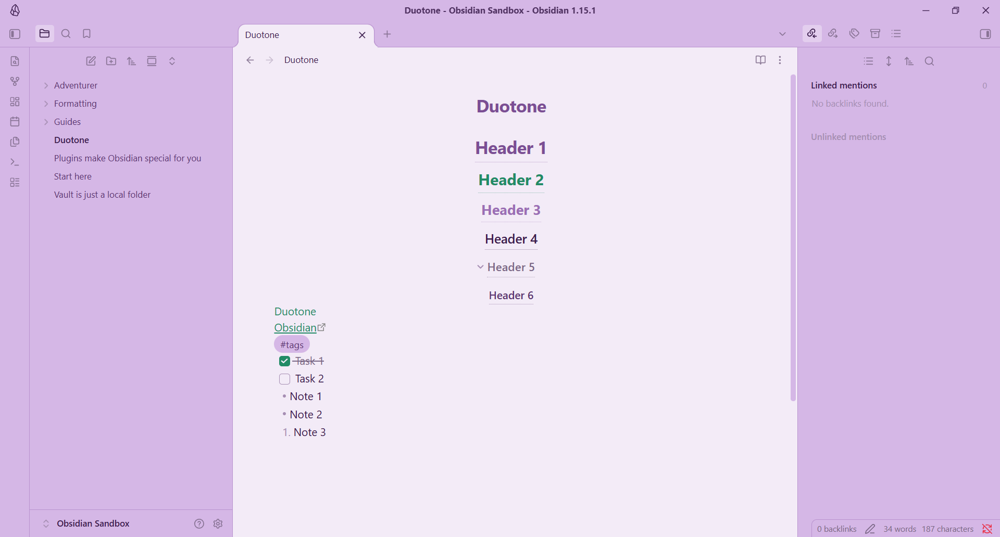
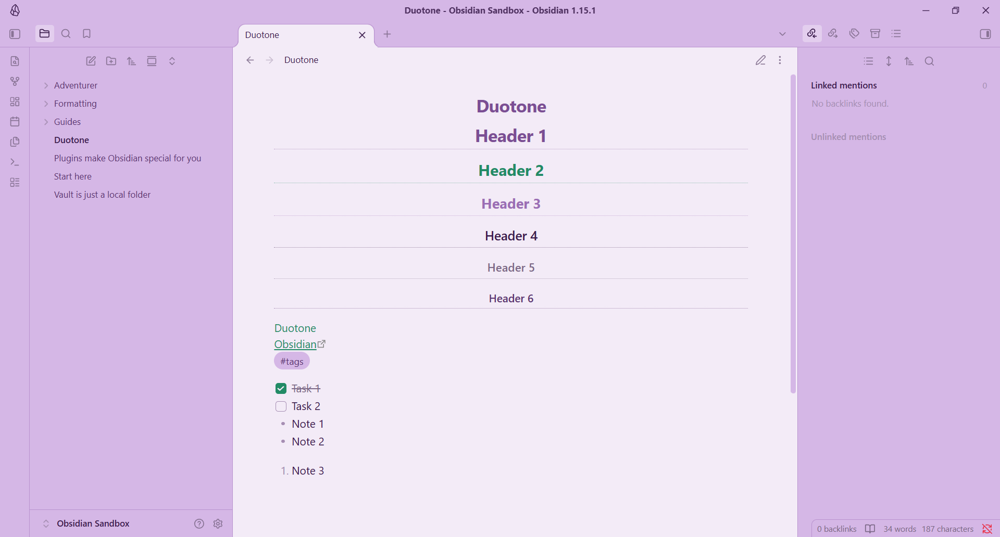
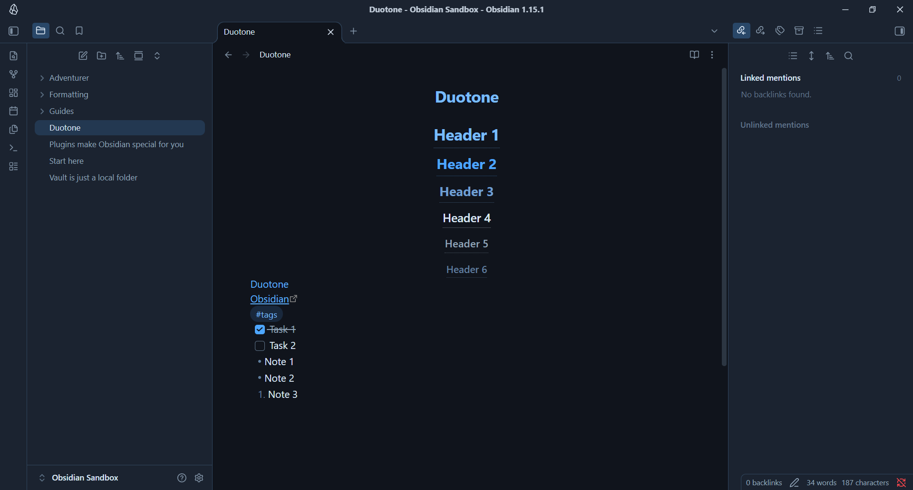
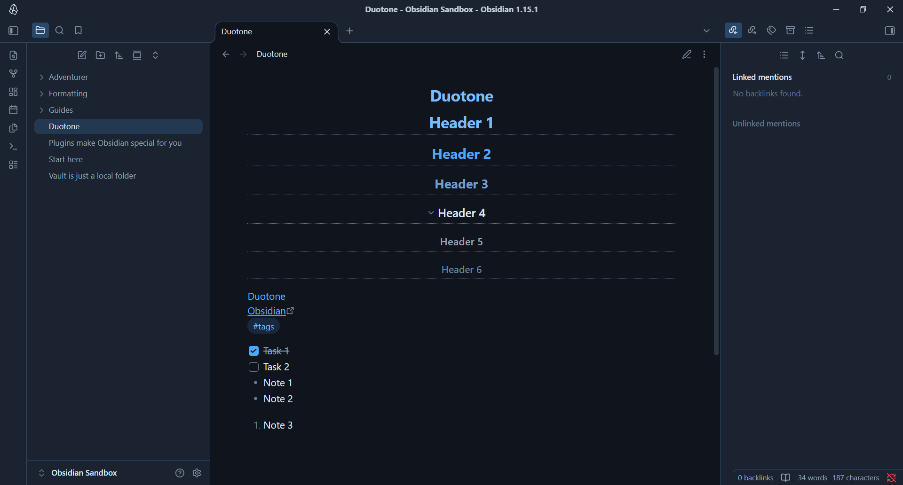

# Duotone

[English](README.md) | [Русский](README-RU.md)

Duotone is a custom theme for Obsidian featuring two distinct color palettes, centered headings, and a consistent visual style across the workspace.

The theme combines a soft lavender light mode with green accents and a cool dark blue mode with bright blue accents.

## Preview

### Light mode

**Live Preview**

**Reading view**

### Dark mode

**Live Preview**

**Reading view**

## Features

- Two distinct color palettes for light and dark modes.
- Custom colors for all six Markdown heading levels.
- Centered Markdown headings and inline note titles.
- Dotted heading underlines in Reading view and Live Preview.
- Centered embedded images in Reading view.
- Customized syntax highlighting.
- Styled internal and external links.
- Customized tags, checkboxes, and tables.
- Custom colors for the file explorer, tabs, menus, dialogs, and other interface elements.
- Customized graph view colors.
- No additional plugins required.

## Color palettes

### Light mode

A soft lavender palette with green accents.

| Element | Color |
| --- | --- |
| Primary background | `#F3EBF7` |
| Secondary background | `#D5B7E6` |
| Primary text | `#3A1C4C` |
| Accent | `#228B66` |

### Dark mode

A cool dark blue palette with bright blue accents.

| Element | Color |
| --- | --- |
| Primary background | `#10141C` |
| Secondary background | `#1B2330` |
| Primary text | `#DCE8F5` |
| Accent | `#4DA6FF` |

## Installation

Duotone is currently distributed through GitHub and is not yet available in the official Obsidian community theme catalog.

### Manual installation

1. Download `theme.css` and `manifest.json` from this repository.
2. Open your Obsidian vault folder.
3. Navigate to `.obsidian/themes/`.
4. Create a folder named `Duotone`.
5. Copy both downloaded files into the newly created folder.
6. Open Obsidian.
7. Navigate to **Settings → Appearance → Themes**.
8. Select **Duotone**.

## Compatibility

- Declared minimum Obsidian version: `1.2.0`.
- Light and dark modes.
- Reading view and Live Preview.

Compatibility with older Obsidian versions has not yet been fully verified.

## Project status

Duotone is under active development.

Future plans include submitting the theme to the official Obsidian community theme catalog.

## Feedback

Bug reports and suggestions are welcome through GitHub Issues.

## Author

Developed by [NekoShift777i](https://github.com/NekoShift777i).

## License

Duotone is licensed under the [MIT License](LICENSE).